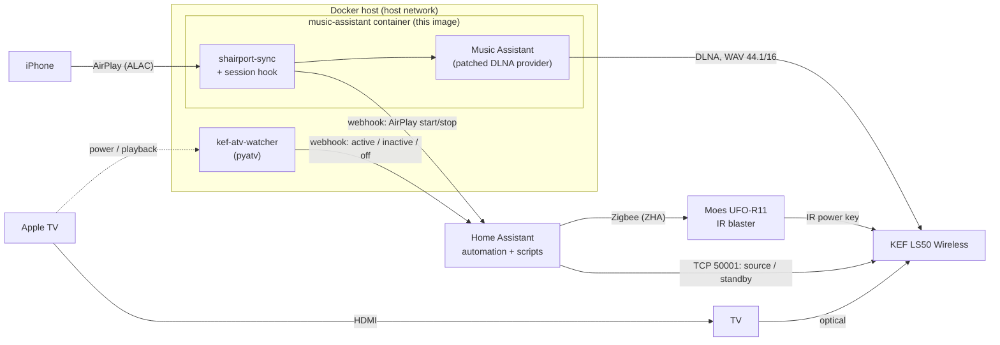

# KEF LS50 Wireless (Gen 1): AirPlay, Apple TV and automatic power

Turns the first-generation **KEF LS50 Wireless** into a lossless AirPlay receiver and automates it
with Home Assistant:

- **AirPlay from iPhone/Mac** to the KEF – lossless (ALAC → bit-perfect WAV 44.1 kHz/16 bit).
- **Automatic power-on from standby** via a Zigbee IR blaster, as soon as an AirPlay stream starts
  or the Apple TV is switched on.
- **Automatic source switching** between Wi-Fi (AirPlay) and Optical (TV via Apple TV).
- **Automatic standby** when the Apple TV is switched off (not when you just pause).

The LS50 Wireless Gen 1 has no AirPlay, and its firmware cannot be extended. It is, however, a
DLNA/UPnP renderer. This project puts [Music Assistant](https://music-assistant.io)'s AirPlay
Receiver in front of it and works around several quirks of the speaker that otherwise break the
experience (standby, boot behaviour, source switching) – see [docs/kef-ls50w-notes.md](docs/kef-ls50w-notes.md).

> Not affiliated with KEF, Apple or the Music Assistant project. Tested with one LS50 Wireless
> (Gen 1), Music Assistant 2.10.8, Home Assistant 2026.10, an Apple TV 4K (tvOS 27) and a Moes UFO-R11.

## Use case

The speakers sit next to a TV and are connected to it with an optical cable. The TV is watched
through an Apple TV. Music comes from iPhones via AirPlay. Nobody should have to grab the KEF remote:

| You do | The KEF does |
|---|---|
| Switch on the Apple TV | wakes up and selects **Optical** (~20 s, while you pick something to watch) |
| Switch off the Apple TV | goes to **standby** (only if it is on Optical and no AirPlay is playing) |
| Start AirPlay on the iPhone (KEF in standby) | wakes up, switches to **Wi-Fi** and plays (~25 s) |
| Start AirPlay while the KEF is on | switches to Wi-Fi and plays (~5 s) |
| Stop AirPlay | goes back to **Optical** after 15 s, then falls asleep via its auto-standby |
| Stop AirPlay while the Apple TV is on | goes back to Optical right away |
| Pause on the Apple TV | nothing – the KEF stays on |

## How it works



1. **AirPlay:** shairport-sync (built into the image) receives the stream. Its session hook
   `kef_power_hook.sh` calls a Home Assistant webhook and waits until the KEF is reachable;
   then Music Assistant plays the stream to the KEF via DLNA. The KEF switches to Wi-Fi by itself.
2. **Power on:** in standby the KEF switches off its whole network module – no Wake-on-LAN, no
   smart plug (it always boots into standby after a power loss). Only the **IR power key** works. Home
   Assistant sends it with a battery-powered Zigbee IR blaster (Moes UFO-R11), wakes the blaster
   first and only sends IR once the blaster confirmed it is awake.
3. **Apple TV:** `kef-atv-watcher` follows the Apple TV with [pyatv](https://pyatv.dev) and reports
   *switched on / playing / switched off* to Home Assistant.
4. **Source and standby:** Home Assistant switches the source and sends standby through the KEF's
   control port (TCP 50001, protocol as in [aiokef](https://github.com/basnijholt/aiokef)) with
   `kef_ctl.py`.

## Requirements

- **KEF LS50 Wireless (Gen 1)** in the LAN (wired or Wi-Fi) with a fixed IP address. The LSX
  (Gen 1) uses the same protocol but is untested. The LS50 Wireless II/LSX II already have AirPlay 2.
- **Linux host with Docker and Docker Compose** on the same LAN (x86_64 tested). Host networking
  is required (mDNS, UPnP). Both containers must be able to reach Home Assistant.
- **Home Assistant** (any installation type) with **ZHA** and a Zigbee coordinator.
- **Moes UFO-R11** Zigbee IR blaster (Tuya TS1201, supported by ZHA's built-in quirk), placed with
  a line of sight to the KEF's IR receiver (the master speaker).
- Optional: **Apple TV** paired with Home Assistant's Apple TV integration.
- Optional: a Home Assistant `notify` entity (e.g. the companion app) for failure messages.

## Setup

### 1. Configure

```bash
git clone https://github.com/jpfrehe/kef-ls50w-airplay.git
cd kef-ls50w-airplay
cp .env.example .env
cp docker-compose.example.yml docker-compose.yml
```

Edit `.env`. At least:

| Variable | Meaning |
|---|---|
| `KEF_HOST` | IP address of the KEF |
| `WEBHOOK_SUFFIX` | random secret, e.g. `openssl rand -hex 12` – webhook IDs are the only authentication |
| `HA_URL` | Home Assistant as seen from the Docker host, usually `http://127.0.0.1:8123` |
| `AVAHI_INTERFACES` | LAN interface of the host (`ip -br addr`), e.g. `eth0` |
| `MA_DATA_DIR`, `HA_CONFIG_DIR` | data directory for Music Assistant; your Home Assistant config directory |
| `ATV_NAME` | title of the Apple TV entry in Home Assistant |
| `IR_IEEE`, `IR_CODE_POWER`, `NOTIFY_ENTITY` | filled in during step 4 |

If Home Assistant does not run on the same host, set `HA_URL` accordingly and make the Apple TV
integration's `.storage` directory available to the watcher (read-only), or skip the watcher.

### 2. Build and start Music Assistant

```bash
docker compose build          # builds shairport-sync, nqptp and patches Music Assistant (~5 min)
docker compose up -d music-assistant
```

Make sure your firewall allows the LAN to reach the host (AirPlay uses a TCP port derived from the
receiver, mDNS UDP 5353; AirPlay 2 additionally UDP 319/320). The receiver is only announced over
IPv4, so an IPv4-only firewall rule is enough.

### 3. Set up Music Assistant

Open `http://<host>:8095` and create the admin account. Then under *Settings*:

1. **Providers:** add **DLNA** – the KEF appears as a player.
2. **Providers:** remove/disable the **AirPlay** *player* provider if you do not need it. It occupies
   UDP 319/320, which nqptp needs in `SHAIRPORT_MODE=airplay2`.
3. **Providers:** add **AirPlay Receiver** and select the KEF as the target player. The receiver
   shows up on your iPhone under the name you give it.
4. **Players → KEF → DLNA settings:** output codec **WAV**, sample rate **44.1 kHz / 16 bit**. Music
   Assistant then passes shairport-sync's PCM through unchanged (bit-perfect). Higher rates or bit
   depths are resampled/padded – measurably faster to start, but audibly worse on the KEF.

Test: play something via AirPlay while the KEF is switched on (Wi-Fi source).

### 4. Set up the IR blaster

1. Pair the UFO-R11 in ZHA (*Add device*, hold its button ~5 s until the LED blinks fast). Put it
   in front of the KEF master speaker. Copy its IEEE address into `IR_IEEE` in `.env`.
2. **Learn the power key:** briefly press the button on the UFO-R11 (it sleeps otherwise), then run
   this action within a few seconds (*Developer tools → Actions*, YAML mode):
   ```yaml
   action: zha.issue_zigbee_cluster_command
   data:
     ieee: "<IR_IEEE>"
     endpoint_id: 1
     cluster_id: 57348      # 0xE004 ZosungIRControl
     cluster_type: in
     command: 1             # IRLearn
     command_type: server
     params:
       on_off: true
   ```
   Point the KEF remote at the blaster from 3-5 cm and press the power key once.
3. **Read the code:** ZHA → device → *Manage Zigbee device* → *Clusters* →
   `ZosungIRControl (0xE004)` → attribute `last_learned_ir_code` → *Read* (press the blaster's button
   again first). Put it into `IR_CODE_POWER`. The code learned in our setup is listed in
   [docs/kef-ls50w-notes.md](docs/kef-ls50w-notes.md); it may work for you as well, but learning
   your own is more reliable. Later you can re-learn with the script **KEF – learn IR key**.
4. Set `NOTIFY_ENTITY` to a notify entity of yours (*Developer tools → States*, filter `notify.`).

### 5. Install the Home Assistant configuration

```bash
python3 tools/render_ha.py      # writes build/homeassistant/{configuration,automations,scripts}.yaml
```

- Copy `image/kef_ctl.py` to `<HA config>/kef/kef_ctl.py` – the `shell_command`s run it with Home
  Assistant's own Python.
- `configuration.yaml`: add the `input_boolean:` and `shell_command:` entries (merge with existing sections).
- `automations.yaml`: append the automation `kef_speaker_control`.
- `scripts.yaml`: append the scripts `kef_power_on`, `kef_ir_wake`, `kef_ir_learn`.

Restart Home Assistant (new `shell_command`s are only loaded on restart).

### 6. Apple TV watcher (optional)

Pair the Apple TV with Home Assistant's **Apple TV** integration and set `ATV_NAME` to the title of
its entry. Then:

```bash
docker compose up -d kef-atv-watcher
docker logs -f kef-atv-watcher    # "connected to ...", "Apple TV active (power On ...)"
```

The watcher reuses Home Assistant's pairing credentials (read-only mount of `.storage`). After
re-pairing the Apple TV, restart the watcher.

### 7. Test

```bash
# KEF status via the control port
docker exec music-assistant python3 /usr/local/bin/kef_ctl.py --host <KEF_HOST> status
# put it into standby, wait ~30 s, then start AirPlay on the iPhone
docker exec music-assistant python3 /usr/local/bin/kef_ctl.py --host <KEF_HOST> standby
# follow the hook
tail -f <MA_DATA_DIR>/kef_power_hook.log
```

Expected: `KEF offline, waiting ...`, then `KEF online and MA reconnected after ~20s`, music ~7 s
later. For tests without an iPhone see [tools/airplay_send.py](tools/airplay_send.py).

## Configuration reference

| Variable (container) | Default | Meaning |
|---|---|---|
| `SHAIRPORT_MODE` | `classic` | `classic` = AirPlay 1, iOS sends lossless ALAC. `airplay2` = AirPlay 2 (Home app, multiroom), but iOS always sends lossy AAC to non-Apple receivers |
| `SHAIRPORT_LATENCY_OFFSET` | `0.0` | seconds; `-1.5` shortens the delay between iPhone and KEF without dropouts |
| `AVAHI_INTERFACES` / `AVAHI_HOSTNAME` | all / `kef-airplay` | mDNS announcement |
| `MA_DLNA_RECONNECT` | – | `1`: reconnect the KEF right after it boots (else up to 300 s) |
| `MA_DLNA_FORCE_CLOSE` | – | `1`: one HTTP connection per DLNA call (required for start from standby) |
| `MA_PAD_BIT_DEPTH` | – | `1`: pad 16 → 24 bit (faster start, sounded worse on the KEF) |
| `KEF_HOST` | – | IP of the KEF (required for the hook) |
| `KEF_WEBHOOK_START` / `_STOP` | – | Home Assistant webhooks for AirPlay start/stop |
| `KEF_BOOT_TIMEOUT` | `150` | max. seconds the hook waits for the KEF |
| `KEF_PLAY_DELAY` | `1` | pause between reconnect and playback start (see notes) |

## Troubleshooting

- **Receiver visible on the iPhone, but nothing plays:** firewall (the iPhone connects to the
  host), or the host's `/etc/hosts` maps `localhost` to something other than 127.0.0.1 (the
  entrypoint fixes this inside the container). `LOG_LEVEL=debug` and the `diagnostics` block in
  `image/shairport-sync.conf.extra` help.
- **KEF does not wake up:** Home Assistant log for `kef_ir_wake` / `kef_power_on`.
  `NWK_NO_ROUTE` / `MAC_NO_ACK` mean the UFO-R11 is asleep or dropped off the Zigbee network. Press
  its button; if it stays unreachable, re-pair it in ZHA (same IEEE, nothing else to change). A
  mains-powered Zigbee router near the blaster and a USB extension cable for the coordinator
  improve the link a lot. To see the IR transfer step by step:
  ```yaml
  logger:
    default: warning
    logs:
      zhaquirks.tuya.ts1201: debug
  ```
  A blaster in your hand during re-pairing will receive queued IR jobs – the power key toggles.
- **KEF wakes up, but AirPlay stays silent:** check `kef_power_hook.log` and the Music Assistant log
  for `DLNA device ... reconnected`. Both `MA_DLNA_RECONNECT=1` and `MA_DLNA_FORCE_CLOSE=1` are
  required.
- **Apple TV not detected:** `docker logs kef-atv-watcher`. Some apps (e.g. Netflix) only report
  "playing" once the video actually runs; switching the Apple TV on is reported immediately.
- **Webhooks arriving while Home Assistant restarts are lost** – just start AirPlay again.
- **After replugging the Zigbee coordinator** restart the Home Assistant container if it runs in
  Docker with a `devices:` mapping (device nodes are bound at container start).

## Updating Music Assistant

1. Change `ARG MA_VERSION` in `image/Dockerfile` and the image tag in `docker-compose.yml`.
2. Check which shairport-sync version Music Assistant ships and pick the matching nqptp version:
   both have to report the same `smi` version (shairport-sync 4.3.7 ↔ nqptp 1.2.8 = smi10).
3. `docker compose build`. The patch scripts **abort the build** if a patched spot in Music
   Assistant changed – then the patches in `image/patch_template.py` / `image/patch_ma.py` need to be
   adapted.

## Repository layout

```
image/                Docker image: Music Assistant + shairport-sync + nqptp + patches
  Dockerfile
  entrypoint.sh       selects AirPlay mode, renders Avahi config, starts dbus/Avahi/nqptp
  patch_template.py   hooks kef_power_hook.sh into MA's shairport-sync template
  patch_ma.py         MA patches: DLNA reconnect, no keep-alive, optional bit-depth padding
  kef_power_hook.sh   shairport-sync session hook (webhook + wait for the KEF)
  kef_ctl.py          KEF control via TCP 50001 (status, on/source, standby, auto-standby)
  atv_watcher.py      Apple TV watcher (pyatv) -> webhooks
homeassistant/        Home Assistant templates with ${VARIABLES} from .env
tools/render_ha.py    renders the templates into build/homeassistant/
tools/airplay_send.py AirPlay test sender (pyatv)
docs/                 measured behaviour of the KEF, the IR blaster and the Apple TV
```

## Credits

- [shairport-sync](https://github.com/mikebrady/shairport-sync) and
  [nqptp](https://github.com/mikebrady/nqptp) by Mike Brady
- [Music Assistant](https://github.com/music-assistant/server)
- [aiokef](https://github.com/basnijholt/aiokef) by Bas Nijholt – the KEF control protocol
- [pyatv](https://github.com/postlund/pyatv) by Pierre Ståhl
- [zha-device-handlers](https://github.com/zigpy/zha-device-handlers) – the UFO-R11 quirk

## License

[MIT](LICENSE). KEF, LS50, Apple TV and AirPlay are trademarks of their respective owners.
